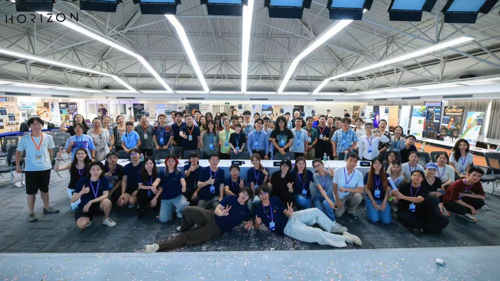

# Echo 陈宇博

**Horizon Startup&元创岛联合创始人兼CTO**

我更喜欢叫自己 builder：把想法做成能运行、能被人用起来的东西。我在产品判断和工程实现之间来回切换，也在博客里记下做过的取舍、踩过的坑，还有没想通的问题。

[个人网站](https://www.echobb.me/) · [关于我](https://www.echobb.me/about/) · [X](https://x.com/Echo101003)

## 精选作品

### Horizon Startup

**72 小时，把一个真实问题做成能上手试的产品原型。**

我在 Horizon Startup 黑客松担任 CTO，负责技术方向和活动官网的实现与交付。官网介绍活动与往届作品，报名门户承接参赛申请。我也负责 Horizon 在内蒙古的落地，把本地社区、活动和项目串起来。

[项目官网](https://horizon-s.cn/) · [报名门户](https://portal.horizon-s.cn/dashboard)

## 其他作品

<table>
<tr>
<td width="50%" valign="top"><strong><a href="https://github.com/cyb101003/video-studio">video-studio</a></strong> 把可灵、Seedance、Veo 等视频模型接到同一套命令里。从分镜到成片，换模型不用重写流程。</td>
<td width="50%" valign="top"><strong><a href="https://github.com/cyb101003/rednote-tools">RealSkill</a></strong> 输入一个选题，三个 AI 写作助手分别起草。保留不同版本，并解释为什么推荐其中一篇。</td>
</tr>
<tr>
<td valign="top"><strong><a href="https://github.com/cyb101003/echo-blog">Echo Blog</a></strong> 用 Astro 搭的个人技术博客，有全文搜索、RSS 和自动同步 GitHub 的项目档案。</td>
<td valign="top"><strong><a href="https://github.com/cyb101003/web3-learning-notes">Web3 学习笔记</a></strong> 把 Web3、区块链和 Solidity 的学习过程留成笔记，连同动手写过的练习一起放出来。</td>
</tr>
<tr>
<td colspan="2" valign="top"><strong><a href="https://github.com/cyb101003/cyb101003">GitHub 主页自动化</a></strong> 用 GitHub Actions 定期生成仓库卡片和语言统计，不必手动刷新项目数据。</td>
</tr>
</table>

## 写作

- [开发之外，这半年的另一份答卷](https://www.echobb.me/posts/beyond-development-half-year/)
- [项目不应该只是一排卡片](https://www.echobb.me/posts/projects-are-not-just-cards/)
