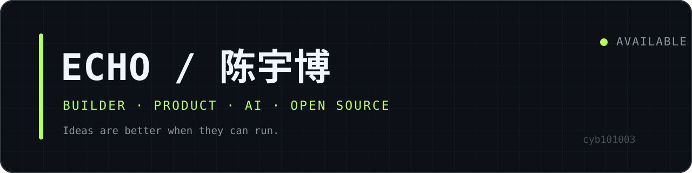
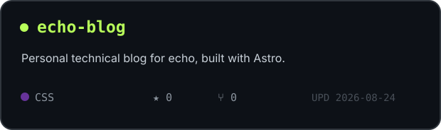
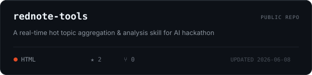
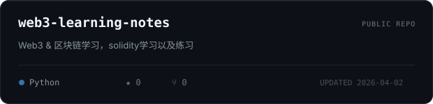
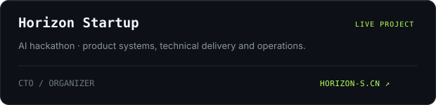
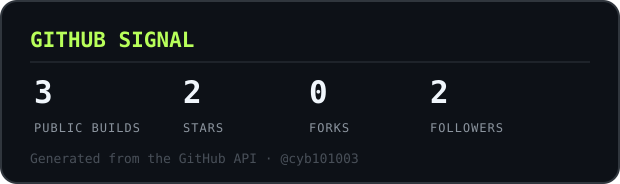
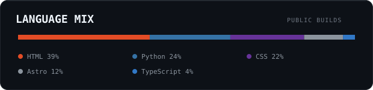

  

  
  
  
  
  

<table>
  <tr>
    <td width="50%" valign="top">
      <h3>01 / PROFILE</h3>
      
<strong>Echo（陈宇博）</strong>，15 岁 builder。

      
元创岛联合创始人 · Horizon AI 产品经理。喜欢把有趣的 ideas 落地，在产品判断、AI 与工程实现之间持续构建。

      
<a href="https://www.echobb.me/about/">Read my story →</a>

    </td>
    <td width="50%" valign="top">
      <h3>02 / NOW</h3>
      <ul>
        <li>Building AI products and web experiences</li>
        <li>Learning Web3, Solidity and open source</li>
        <li>Writing project notes at <a href="https://www.echobb.me">echobb.me</a></li>
        <li>CTO / organizer at <a href="https://horizon-s.cn">Horizon Startup</a></li>
      </ul>
    </td>
  </tr>
</table>

## Selected work

  
  

  
  

## Stack

  
  
  
  
  
  
  
  

## GitHub signal

  
  

  <a href="https://github.com/cyb101003?tab=repositories">All repositories</a>
  &nbsp;·&nbsp;
  <a href="https://www.echobb.me/posts/">Writing</a>
  &nbsp;·&nbsp;
  <a href="https://www.echobb.me/projects/">Projects</a>

